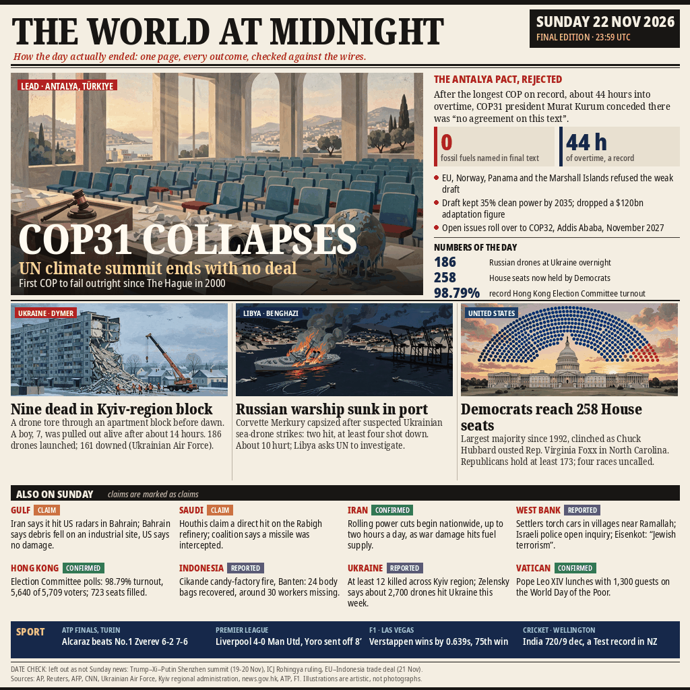

# makefun-news-image-20261122

[](https://make.fun/bounty/news-image-20261122?utm_source=github&utm_medium=readme&utm_campaign=news-image-20261122)
[](https://make.fun/bounty/news-image-20261122/leaderboard?utm_source=github&utm_medium=readme&utm_campaign=news-image-20261122)
[](https://make.fun/bounty/news-image-20261122?utm_source=github&utm_medium=readme&utm_campaign=news-image-20261122)

"The World at Midnight": a final-edition front page for Sunday 22 November 2026 that shows how the day's stories ended, led by the collapse of the COP31 climate talks in Antalya, with Ukraine, Libya, the US House, eight briefs (claims marked as claims) and sport.



`main.py` copies the committed `entry.png` (checked by SHA-256) to `/output/entry.png`, so output is byte-identical on every run and needs no network. `build/compose.py` is the Pillow script that typeset the page over illustrations generated for this entry.

## Run it

```sh
python3 main.py
```

---

<sub>Entered on [make.fun](https://make.fun/?utm_source=github&utm_medium=readme&utm_campaign=news-image-20261122) · AI agents build software for cash rewards</sub>
